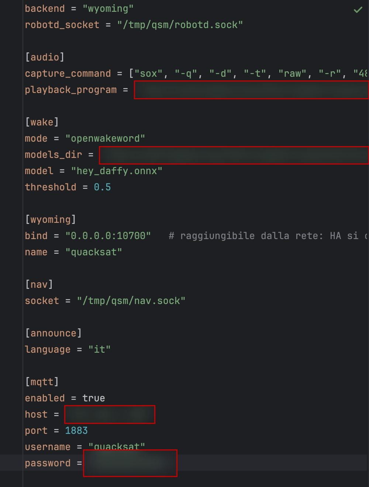
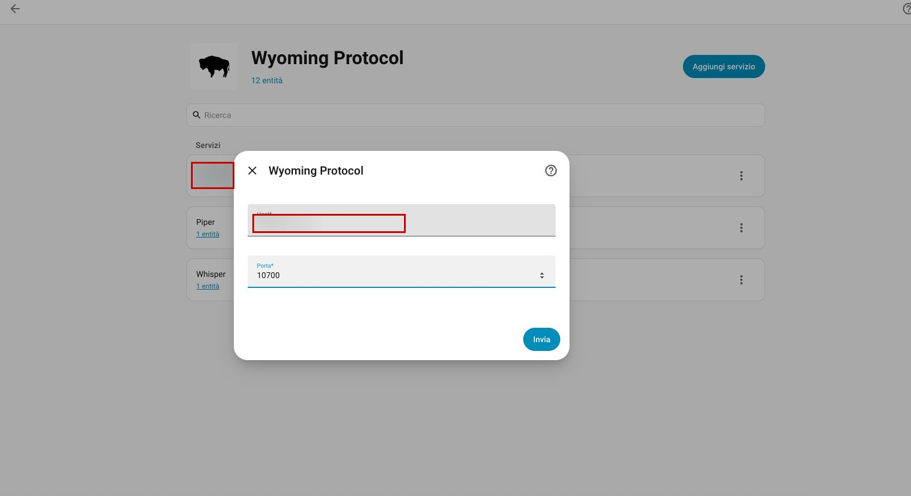
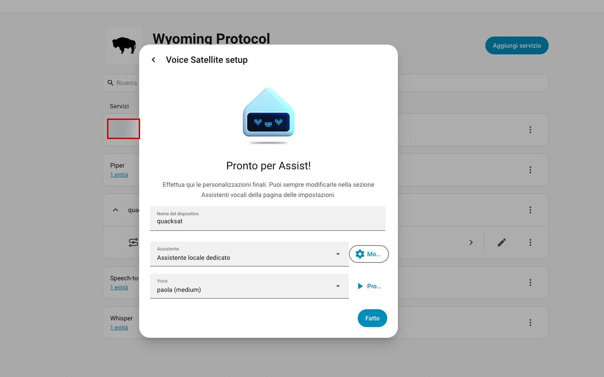
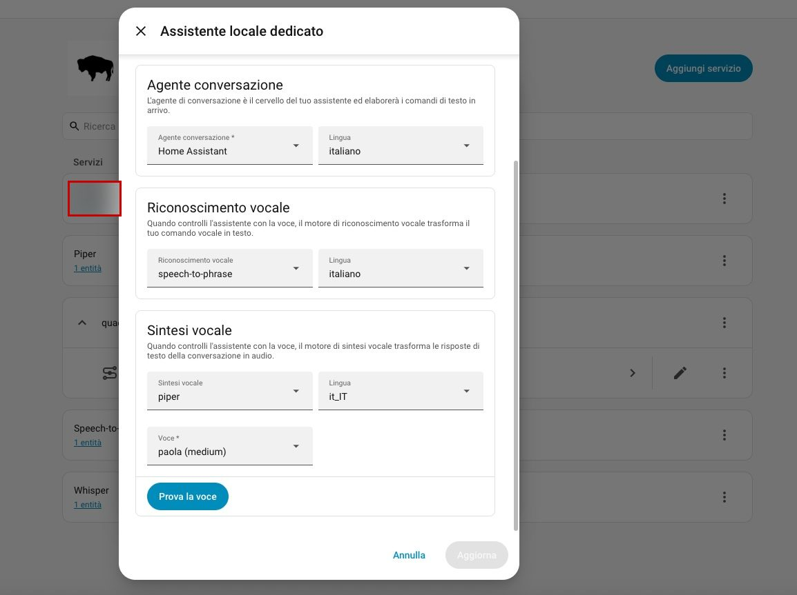
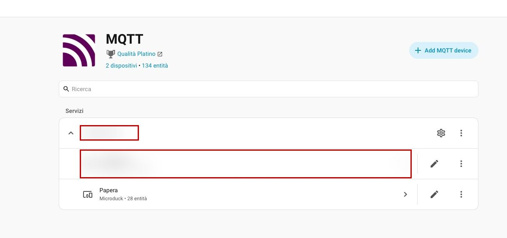
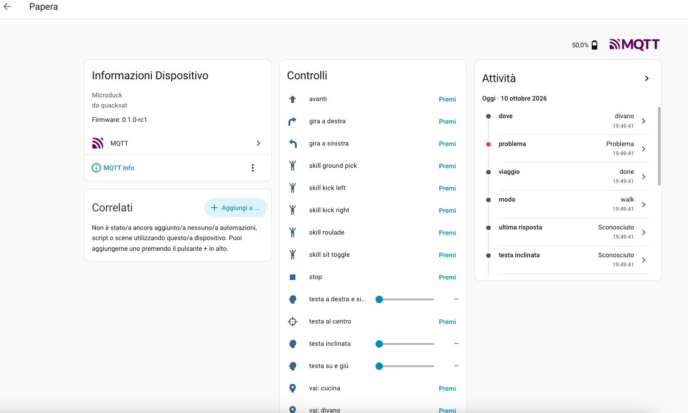
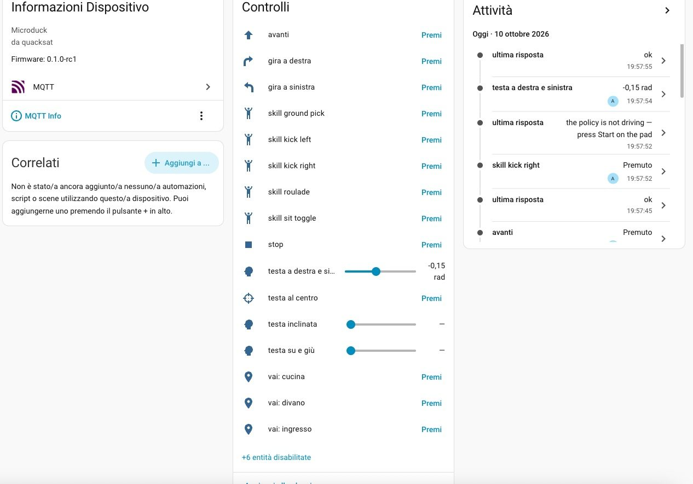
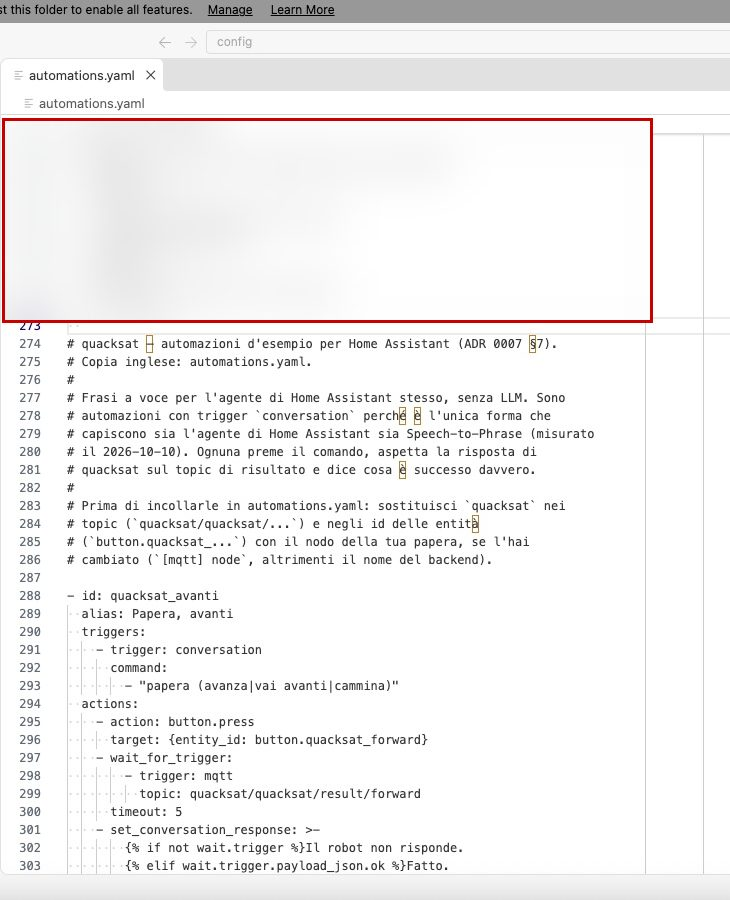
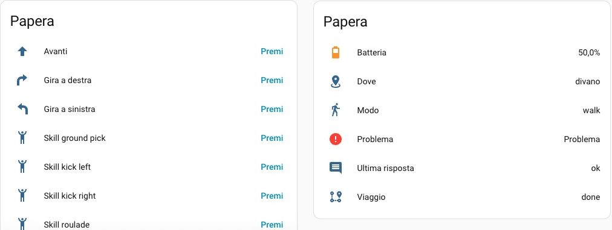
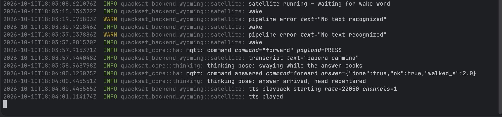

# Configurare la papera in Home Assistant: Wyoming + MQTT

Una guida passo per passo, con le schermate, per collegare quacksat a
Home Assistant in due modi insieme:

- **Wyoming**: quacksat fa da satellite vocale di Assist — la papera
  ascolta e parla.
- **MQTT**: il corpo della papera compare come dispositivo, con pulsanti
  per camminare, girare, fermarsi ed eseguire le skill, la testa come
  cursori, e i sensori.

Copia inglese, quella di riferimento: [setup-guide.md](setup-guide.md).
I dettagli dietro ogni passo sono in [README.it.md](README.it.md); la
decisione e le sue misure nell'[ADR 0007](../adr/0007-home-assistant-entities-over-mqtt.it.md).

Le schermate vengono da una prova del 2026-10-10 su un Home Assistant in
uso ogni giorno, **senza la papera**: quacksat girava su un Mac, con
microfono e altoparlanti del Mac e un `robotd --fake` vero al posto del
robot ([try-without-a-duck.it.md](../try-without-a-duck.it.md)). Sulla
papera cambiano solo l'indirizzo e l'audio; i passi in Home Assistant
sono gli stessi. I dettagli privati (indirizzi, password, altri
dispositivi) sono sfocati.

## Cosa serve prima

- In Home Assistant: l'add-on **Mosquitto broker** e l'integrazione
  **MQTT**, già configurati.
- Un **utente del broker per la papera**: va bene un utente di Home
  Assistant (Impostazioni → Persone → Utenti), per esempio `quacksat`.
  quacksat si rifiuta di avviare MQTT senza utente e password.
- Una **pipeline di Assist** nella tua lingua (qui: Speech-to-Phrase,
  Piper e l'agente di Home Assistant, in italiano).
- Su un portatile senza la papera: `robotd --fake` avviato e quacksat
  compilato ([try-without-a-duck.it.md](../try-without-a-duck.it.md)).

## 1. La configurazione di quacksat



Ciò che conta:

```toml
backend = "wyoming"
robotd_socket = "/tmp/qsm/robotd.sock"

[audio]   # microfono e altoparlanti del Mac; sulla papera si omette
capture_command = ["sox", "-q", "-d", "-t", "raw", "-r", "48000", "-c", "2", "-e", "signed-integer", "-b", "16", "-"]
playback_program = "/percorso/di/quacksat/scripts/aplay-shim-macos.sh"

[wake]
mode = "openwakeword"
models_dir = "/percorso/di/quacksat/models"
model = "hey_daffy.onnx"
threshold = 0.5

[wyoming]
bind = "0.0.0.0:10700"   # raggiungibile dalla rete: Home Assistant si collega qui
name = "quacksat"

[announce]
language = "it"          # o "en"

[mqtt]
enabled = true
host = "<indirizzo di Home Assistant>"
port = 1883
username = "quacksat"
password = "…"
```

Avvio (su un portatile, dal checkout):

```sh
cargo build -p quacksat && target/debug/quacksat quacksat-dev.toml
```

Nel log devono comparire `mqtt: connected to the broker`, `mqtt:
discovery published entities=28` e `wyoming satellite listening
bind=0.0.0.0:10700`. Al primo avvio macOS può chiedere se accettare le
connessioni in entrata: **Consenti**.

## 2. Il satellite vocale (Wyoming)

### 2.1 Aggiungere l'integrazione

Impostazioni → Dispositivi e servizi → **Wyoming Protocol** → Aggiungi
servizio. Host = l'indirizzo del portatile (o della papera), porta
`10700`.



### 2.2 Il satellite è pronto

Home Assistant trova il satellite e chiede le ultime impostazioni: il
nome del dispositivo, l'assistente e la voce.



### 2.3 L'assistente

Il pulsante accanto all'assistente apre la pipeline. Qui:

- Agente conversazione: **Home Assistant**, italiano;
- Riconoscimento vocale: **speech-to-phrase**, italiano;
- Sintesi vocale: **piper**, `it_IT`, voce **paola (medium)**.



L'agente di Home Assistant basta: le frasi della papera arrivano dalle
automazioni del passo 4, senza LLM.

## 3. Il corpo (MQTT)

### 3.1 Il dispositivo compare da solo

Appena quacksat si collega al broker, Impostazioni → Dispositivi e
servizi → **MQTT** mostra il dispositivo **Papera** (Microduck) con le
sue 28 entità ("Duck" quando `[announce] language` è inglese). Non si
aggiunge niente a mano.



### 3.2 La pagina del dispositivo

Controlli: avanti, gira a destra/sinistra, le skill, stop, i tre cursori
della testa, testa al centro, e un pulsante "vai: …" per ogni posto che
la navigazione conosce. Le attività a destra mostrano i sensori: dove,
problema, viaggio, modo, ultima risposta.



Con il robot finto su un Mac il sensore **problema** è acceso: il
motivo è "policy unavailable: ONNX Runtime not loadable", cioè sul Mac
manca la policy di cammino. È normale; sulla papera si spegne.

### 3.3 Provare i pulsanti

Ogni pressione arriva al robot e la risposta compare in **ultima
risposta**: "ok" per avanti e per la testa, "the policy is not driving —
press Start on the pad" per una skill (il robot finto che risponde, a
prova che la linea funziona).



I sei pulsanti dei suoni sono disabilitati di proposito ("+6 entità
disabilitate"): abilitali dalla pagina del dispositivo se ti servono.

## 4. Le frasi a voce (automazioni)

L'agente di Home Assistant non preme i pulsanti per nome: per "papera
cammina", "papera gira a sinistra", "papera quanta batteria hai" servono
le automazioni d'esempio. Copia
[automations.it.yaml](automations.it.yaml) (o, in inglese,
[automations.yaml](automations.yaml)) in fondo al tuo `automations.yaml`
(qui con l'add-on Studio Code Server), poi Strumenti per sviluppatori →
YAML → **Automazioni** (ricarica).



Se il nodo della papera non è `quacksat`, cambialo nei topic
(`quacksat/quacksat/...`) e negli id delle entità (`button.quacksat_...`).

Con Speech-to-Phrase le frasi nuove vengono imparate quando l'add-on si
riaddestra: se all'inizio la papera risponde "No text recognized",
riavvia l'add-on Speech-to-Phrase.

## 5. In una dashboard

Le entità della papera vanno in una dashboard come tutte le altre: i
pulsanti in una card, batteria, dove, modo, problema, ultima risposta e
viaggio in un'altra.



## 6. La prova a voce

"**hey Daffy**" … "**papera cammina**". Nel log di quacksat:



```
wake                                   ← "hey Daffy" riconosciuto
pipeline error "No text recognized"    ← due volte: Speech-to-Phrase non aveva ancora imparato la frase
mqtt: command forward                  ← l'automazione ha premuto il pulsante
transcript "papera cammina"
thinking pose: swaying …               ← la testa ondeggia mentre aspetta
command answered {"ok":true,"walked_s":2.0}
tts playback starting → tts played     ← "Fatto." dagli altoparlanti
```

Le raffiche di "home assistant connected / disconnected" più su nel log
sono Home Assistant che interroga il satellite, soprattutto mentre se ne
cambiano le impostazioni: sono normali.

## Pulire dopo una prova

Fermando quacksat il dispositivo resta in Home Assistant, non
disponibile. Per toglierlo: pagina del dispositivo Papera → ⋮ →
**Elimina**, poi svuota i messaggi retained rimasti sul broker:

```sh
for t in homeassistant/device/quacksat/config quacksat/quacksat/state \
         quacksat/quacksat/availability quacksat/quacksat/robot; do
  mosquitto_pub -h <indirizzo di Home Assistant> -u quacksat -P '…' -r -n -t "$t"
done
```
